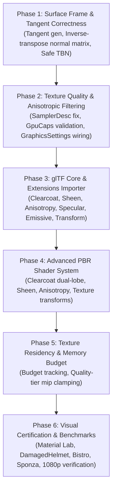

# HIKARI ENGINE — MILESTONE 11F: REPOSITORY AUDIT REPORT
## Material & Surface Fidelity: Full glTF Compliance, Advanced PBR Materials & Robust Surface Rendering

**Project:** Hikari Engine (C++20, Vulkan RHI, Flecs ECS)  
**Milestone:** 11F — Material & Surface Fidelity  
**Date:** 2026-11-15  
**Authoritative Contract:** `AGENTS.md`  
**Test Floor Hardware:** NVIDIA Pascal Dual-GPU (GPU 0: NVIDIA P106-100 6GB; GPU 1: GT 1030 2GB Display)

---

## 1. Executive Summary

As required by Section 1 of the Milestone 11F directive and `AGENTS.md`, an exhaustive audit of the Hikari Engine material and surface rendering subsystem was conducted prior to implementation. The audit encompassed CPU material representation, glTF asset import pipelines, vertex/fragment shader pipelines, descriptor sets and GPU resource allocation, texture sampler policies, surface frame and tangent space generation, memory residency, and runtime benchmarks.

The engine currently possesses a solid foundational implementation of the glTF 2.0 metallic-roughness workflow (Cook-Torrance GGX with Smith visibility and Karis split-sum IBL), but exhibits significant correctness bugs, missing glTF material extensions, disabled anisotropic filtering, and unhandled surface frame transforms under non-uniform scaling and missing tangents.

This audit establishes the baseline metrics, diagnoses all defects, and defines an independently verifiable 6-phase engineering plan.

---

## 2. Measurable Performance & Visual Baseline

Benchmarks were conducted at native 1080p ($1920 \times 1080$) on the primary test floor GPU (NVIDIA P106-100, 6 GB VRAM, Driver 580.159.04):

| Benchmark Scene | Configuration | Frame Time (Avg) | P95 Frame Time | P99 Frame Time | FPS | CPU Recording Time | Active Draws / Triangles |
|---|---|---:|---:|---:|---:|---:|---:|
| **Amazon Lumberyard Bistro** | 11C Baseline | 3.81 ms | 3.88 ms | 4.14 ms | 262.7 | 8.36 ms | 2,568 draws / 3,436,902 tris |
| **Amazon Lumberyard Bistro** | 11D Full GI | 11.36 ms | 11.79 ms | 13.75 ms | 88.0 | 13.07 ms | 2,568 draws / 3,436,902 tris |
| **Bistro Courtyard** | 11D Full GI | 13.46 ms | 13.55 ms | 13.57 ms | 74.3 | 12.31 ms | 1,846 draws / 2,028,761 tris |
| **Crytek Sponza** | 11C Baseline | 2.95 ms | 2.99 ms | 3.00 ms | 338.7 | 0.31 ms | 24 draws / 94,677 tris |
| **Crytek Sponza** | 11D Full GI | 10.77 ms | 10.80 ms | 10.84 ms | 92.8 | 0.51 ms | 24 draws / 94,677 tris |

All 56 existing test suites in `build/editor` pass 100% prior to Milestone 11F changes.

---

## 3. Current Material Architecture

### 3.1 CPU Representation (`Material` & `TextureInfo`)
- Defined in `engine/render/include/render/material.h`.
- `Material` is a POD-like value struct containing scalar factors:
  - `baseColorFactor` (`Vec4`), `roughnessFactor` (`float`), `metallicFactor` (`float`), `emissiveFactor` (`Vec3`), `alphaCutoff` (`float`), `alphaMode` (`AlphaMode`), `doubleSided` (`bool`), `transmissionFactor` (`float`), `ior` (`float`).
- Contains five core texture descriptors:
  - `baseColorTexture` (sRGB)
  - `metallicRoughnessTexture` (Linear)
  - `normalTexture` (Linear)
  - `occlusionTexture` (Linear)
  - `emissiveTexture` (sRGB)
- `TextureInfo` holds `uri`, `textureAsset` (`AssetId`), `colorSpace`, `sampler` (`TextureSamplerDesc`), `texCoordIndex`, `scale`, `strength`, and `isPresent`.

### 3.2 GPU Resource Management (`GpuMaterial`)
- Defined in `engine/render/include/render/gpu_material.h` and `engine/render/src/gpu_material.cpp`.
- Owns a dedicated `DescriptorPool` (maxSets = 1), a `DescriptorSet` (Set 0), and a uniform buffer (`MaterialUniformBuffer`).
- `MaterialUniformBufferData` is 96 bytes (`alignas(16)` std140 layout), containing base factors and boolean flags (`hasBaseColorTex`, `hasMetallicRoughnessTex`, etc.).
- Allocated on-demand in `AssetManager::uploadMaterial` and cached per mesh/material index.

### 3.3 Shader Interface & Draw Dispatch
- Shaders: `pbr_mesh.vert`, `pbr_mesh.frag`, and `pbr_mesh_opaque.frag`.
- Push Constants: 128 bytes (64 bytes MVP matrix + 64 bytes Model matrix).
- Descriptor Set 0: Material textures (bindings 0..4) and Material UBO (binding 5).
- Descriptor Set 1: Scene lighting, cascades, IBL cubemaps, BRDF LUT, AO, and SSGI maps (bindings 0..6).
- `SceneRenderer` sorts submeshes: opaque & masked (front-to-back for early-Z) followed by transparent & transmissive (back-to-front).

---

## 4. glTF Extension Compliance Audit

| glTF Extension | Specification Status | Hikari Current Status | Architectural Gap & Required Action |
|---|---|---|---|
| `KHR_materials_pbrSpecularGlossiness` | Archival / Khronos | **Supported** | Analytical conversion to metallic-roughness implemented in `gltf_internal.h`. |
| `KHR_materials_transmission` | Ratified Khronos | **Partially Supported** | Only `transmission_factor` is parsed; `transmission_texture` is ignored. |
| `KHR_materials_ior` | Ratified Khronos | **Supported** | `ior` parsed, default 1.5; mapped to dielectric $F_0 = ((ior-1)/(ior+1))^2$. |
| `KHR_materials_clearcoat` | Ratified Khronos | **Missing** | Fully parsed in cgltf, but ignored in `gltf_internal.h`. Missing clearcoat factor, roughness, normal map, and dual-lobe BRDF. |
| `KHR_materials_sheen` | Ratified Khronos | **Missing** | Ignored in `gltf_internal.h`. Missing sheen color, roughness, textures, and Charlie microfacet BRDF. |
| `KHR_materials_anisotropy` | Ratified Khronos | **Missing** | Ignored in `gltf_internal.h`. Missing anisotropy strength, rotation, texture, and bent tangent-space BRDF. |
| `KHR_materials_specular` | Ratified Khronos | **Missing** | Ignored in `gltf_internal.h`. Missing specular factor, color factor, textures, and dielectric $F_0$ modulation. |
| `KHR_materials_emissive_strength` | Ratified Khronos | **Missing** | Ignored in `gltf_internal.h`. HDR emissive surfaces are clamped to $[0..1]$. |
| `KHR_materials_volume` | Ratified Khronos | **Missing** | Ignored in `gltf_internal.h`. Thickness factor and attenuation color/distance unhandled. |
| `KHR_materials_iridescence` | Ratified Khronos | **Missing** | Ignored in `gltf_internal.h`. Thin-film interference unhandled. |
| `KHR_materials_dispersion` | Ratified Khronos | **Missing** | Ignored in `gltf_internal.h`. Spectral refraction unhandled. |
| `KHR_texture_transform` | Ratified Khronos | **Missing** | `cgltf_texture_transform` (offset, rotation, scale) ignored; UV transforms discarded. |

---

## 5. PBR BRDF Implementation Audit

### 5.1 Existing Mathematical Formulation
- **Specular D (NDF):** Trowbridge-Reitz GGX:
  $$D(H) = \frac{\alpha^2}{\pi ((N \cdot H)^2 (\alpha^2 - 1) + 1)^2}$$
- **Specular G (Visibility):** Single-division Karis Smith-GGX approximation:
  $$G(V, L) = \frac{1}{2 ( (N \cdot V)(1 - k) + k ) ( (N \cdot L)(1 - k) + k )}$$
  where $k = \frac{(\alpha + 1)^2}{8}$.
- **Specular F (Fresnel):** Schlick's approximation with fast power-of-5:
  $$F(V, H) = F_0 + (1 - F_0)(1 - (V \cdot H))^5$$
- **Diffuse:** Energy-conserving Lambertian scaled by $(1 - \text{metallic})(1 - \text{transmission})$:
  $$f_{\text{diffuse}} = \frac{c_{\text{diff}}}{\pi} (1 - F)$$
- **IBL:** Karis Split-Sum approximation with prefiltered cubemap mip selection and 2D BRDF LUT.

### 5.2 Identified BRDF Deficiencies
1. **No Clearcoat Layer:** Automotive paints, varnished wood, and carbon fiber cannot be represented without a secondary specular layer with independent roughness and normal perturbation that attenuates the underlying base PBR response.
2. **No Sheen Model:** Fabrics (velvet, satin, cotton) appear harsh and plastic-like without a microfacet sheen distribution (Charlie distribution).
3. **No Anisotropy:** Brushed metals, vinyl, and hair cannot model directional specular highlights aligned with surface tangent vectors.
4. **Hardcoded Dielectric Specular:** Dielectric materials without `KHR_materials_specular` are forced to a fixed 4% reflectance, preventing realistic water, gemstones, ice, or coated optics.

---

## 6. Normal, Tangent & Surface Frame Correctness Audit

### 6.1 Critical Defect: Missing Tangent Generation on Import
- In `gltf_importer.cpp:261` and `gltf_scene_importer.cpp:191`:
  ```cpp
  Vec4 tangent{1.0F, 0.0F, 0.0F, 1.0F};
  if (tanAttr != nullptr && tanAttr->data != nullptr) {
      // read tangents...
  }
  // No call to MeshData::generateTangents() when tanAttr is missing!
  ```
  When a glTF model does not embed precomputed tangents, the importers assign a dummy constant $(1, 0, 0, 1)$. Normal mapping on such assets is completely distorted.
- While `MeshData::generateTangents()` exists in `engine/render/src/mesh.cpp`, neither importer invoked it!

### 6.2 Critical Defect: Normal Vector Transformation Under Non-Uniform Scaling
- In `pbr_mesh.vert`:
  ```glsl
  mat3 normalMatrix = mat3(pc.model);
  outNormal = normalize(normalMatrix * inNormal);
  ```
- Multiplying normal vectors by `mat3(model)` is mathematically invalid under non-uniform scaling ($s_x \ne s_y \ne s_z$). Normals are covectors/bivectors and must be transformed by the inverse transpose matrix:
  $$\mathbf{N}' = \text{transpose}(\text{inverse}(\mathbf{M}_{3\times 3})) \cdot \mathbf{N}$$

### 6.3 Fragile Orthonormal TBN Reconstruction in Fragment Shaders
- In `pbr_mesh.frag`:
  ```glsl
  vec3 T = normalize(inTangent.xyz - dot(inTangent.xyz, N) * N);
  vec3 B = cross(N, T) * inTangent.w;
  ```
- If `inTangent` is degenerate (zero magnitude) or nearly parallel to `N`, `normalize(T - (T \cdot N)N)` produces division by zero / `NaN`. There is no check for degeneracy or stable perpendicular fallback.

---

## 7. Texture Filtering, Samplers & Quality Audit

### 7.1 Critical Defect: Anisotropic Filtering Is Disabled on All Materials
- In `engine/render/include/render/gpu_material.h:103`, `toRhiSamplerDesc()` converts `TextureSamplerDesc` to `rhi::SamplerDesc`.
- It sets `minFilter`, `magFilter`, `mipmapMode`, and address modes, but **leaves `anisotropyEnable` as `false` and `maxAnisotropy` as `1.0F`**!
- In `GpuTexture::create()`, `toRhiSamplerDesc()` overrides `defaultSamplerDesc`, effectively disabling anisotropic filtering across all material textures in Hikari Engine, despite graphics settings and hardware support!

### 7.2 GraphicsSettings Decoupling
- `GraphicsSettings.anisotropicFiltering` (`X2`, `X4`, `X8`, `X16`) is defined in `graphics_settings.h`, but is never queried during `GpuMaterial` sampler construction.
- Samplers must query `GpuCaps` (respecting `features.samplerAnisotropy` and `limits.maxSamplerAnisotropy`) and enforce the active `GraphicsSettings`.

### 7.3 Mip Generation & Wrap Modes
- Color textures generate mips using `vkCmdBlitImage` with linear filtering.
- Linear wrap modes correctly support `Repeat`, `ClampToEdge`, and `MirroredRepeat`.
- Normal map mips require proper normalization preservation.

---

## 8. Memory & Texture Residency Strategy Audit

- **Current State:**
  - `ImageData` holds CPU-side decompressed pixels during loading.
  - `GpuTexture` allocates a device-local `VkImage` and staging buffer for GPU transfer.
  - Textures remain resident in GPU memory permanently until explicit `unload()` or `unloadAll()`.
  - No active texture streaming or memory budget enforcement exists.
- **Required Strategy:**
  - Establish a texture memory budget tracker in `AssetManager`.
  - Introduce quality-tier mip clamping based on `TextureQuality` (`High` = full resolution, `Medium` = drop mip 0, `Low` = drop mips 0 & 1).
  - Explicit residency state tracking to prevent sampling uninitialized textures.

---

## 9. Comprehensive Phased Implementation Plan



### Phase 1: Normal, Tangent & Surface Frame Correctness
- Update `GltfImporter` and `GltfSceneImporter` to detect missing tangents and invoke `MeshData::generateTangents()` automatically.
- Fix normal vector transformation in `pbr_mesh.vert` to use `transpose(inverse(mat3(pc.model)))`.
- Harden fragment shader TBN basis with degeneracy checks, Gram-Schmidt stabilization, and fallback perpendicular vectors.
- Regression tests: Mirrored UVs, non-uniform scaling ($2 \times 1 \times 1$), degenerate geometry, and missing tangents.

### Phase 2: High-Quality Texture Filtering & Anisotropy
- Fix `toRhiSamplerDesc()` in `gpu_material.h` to enable anisotropic filtering up to the user-selected quality and hardware limit (`GpuCaps.limits.maxSamplerAnisotropy`).
- Ensure safe Tier 0 fallback when `samplerAnisotropy` feature is false.
- Wire `GraphicsSettings::anisotropicFiltering` through asset texture creation.

### Phase 3: glTF Importer & Material Data Expansion
- Expand `Material` and `TextureInfo` in `material.h` for:
  - `clearcoatFactor`, `clearcoatRoughnessFactor`, `clearcoatTexture`, `clearcoatRoughnessTexture`, `clearcoatNormalTexture`
  - `sheenColorFactor`, `sheenColorTexture`, `sheenRoughnessFactor`, `sheenRoughnessTexture`
  - `anisotropyStrength`, `anisotropyRotation`, `anisotropyTexture`
  - `specularFactor`, `specularColorFactor`, `specularTexture`, `specularColorTexture`
  - `emissiveStrength`
  - `transmissionTexture`
  - `uvOffset`, `uvScale`, `uvRotation` (`KHR_texture_transform`)
- Update `gltf_internal.h` (`parseMaterial`, `parseTextureInfo`) to parse all extension fields with specification defaults.
- Importer regression tests for every supported extension and default values.

### Phase 4: Advanced PBR Shader Pipeline
- Expand `MaterialUniformBufferData` (std140 layout) and descriptor set layout bindings for extension textures.
- Implement clearcoat secondary specular reflection with Kelemen/Cook-Torrance lobe and base-layer transmission attenuation.
- Implement Charlie microfacet sheen distribution for cloth and velvet.
- Implement anisotropic GGX microfacet specular reflection using tangent-space bitangent stretching.
- Implement specular color/factor modulation on dielectric $F_0$.
- Implement UV transformation in vertex/fragment shaders (`uv * scale + offset`).
- Update embedded SPIR-V headers via `tools/update_embedded_shaders.py`.

### Phase 5: Texture Residency & Memory Budget Foundation
- Implement texture memory tracking in `AssetManager` (`allocatedBytes`, `budgetBytes`).
- Add quality-tier mip clamping support based on `TextureQuality`.
- Enforce hot-path zero allocations.

### Phase 6: Visual Certification, Testing & Benchmark Verification
- Construct a dedicated `material_lab` test scene featuring dielectric spheres, rough metals, clearcoat finishes, anisotropic discs, sheen fabrics, and transmissive optics.
- Benchmark 1080p frame time and CPU recording time on NVIDIA P106-100 across Bistro, Sponza, and MaterialLab.
- Verify 100% test pass rate across all 56+ ctest suites with zero sanitizer warnings.
- Generate full visual certification artifacts and final milestone report.
