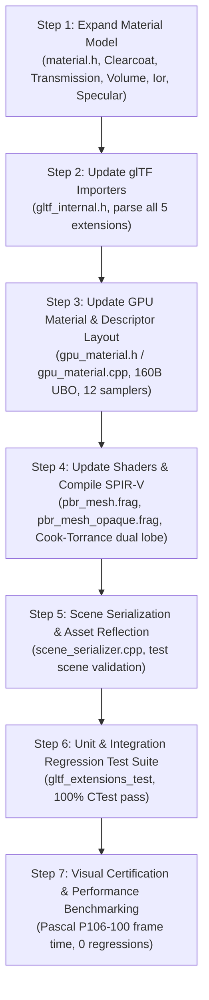

# Hikari Engine — Milestone 11F: Material & Surface Fidelity
# Phase 3 Audit & Implementation Specification: Advanced glTF Material Extensions

**Project:** Hikari Engine  
**Milestone:** 11F (Material & Surface Fidelity)  
**Phase:** Phase 3 (Advanced glTF Material Extensions)  
**Auditor:** Principal Rendering Architect  
**Date:** 2026-11-15  
**Hardware Baseline:** NVIDIA GeForce GTX 1060 / P106-100 (Pascal Architecture, 6GB VRAM, Vulkan 1.3)

---

## 1. Executive Summary & Purpose

Milestone 11F Phase 3 elevates the Hikari Engine material system from standard glTF 2.0 metallic-roughness to industry-standard advanced surface shading by implementing five core Khronos PBR material extensions:
1. `KHR_materials_clearcoat`: Dual-layer specular coat for automotive paint, lacquered wood, carbon fiber, and glazed surfaces.
2. `KHR_materials_transmission`: Optical transmission for thin and thick glass, plastics, and transparent surfaces.
3. `KHR_materials_volume`: Absorption and scattering through volumetric media based on the Beer-Lambert law.
4. `KHR_materials_ior`: Physically accurate index of refraction defining dielectric Fresnel $F_0$.
5. `KHR_materials_specular`: Direct modulation of dielectric specular reflectance factor and tint.

This audit establishes the exact hardware limits, data pipelines, descriptor layouts, shader equations, and implementation strategy prior to modifying source code.

---

## 2. Parser & Dependency Audit (`cgltf.h`)

`engine/render/src/cgltf/cgltf.h` is pinned at version 1.14 (`cgltf` single-header C99/C++ compatible library).
The audit confirmed full, native parsing support for all five extensions:

| Extension | `cgltf` Struct | Fields Available in Parser | Parser Status |
| :--- | :--- | :--- | :--- |
| `KHR_materials_clearcoat` | `cgltf_clearcoat` | `clearcoat_factor`, `clearcoat_roughness_factor`, `clearcoat_texture`, `clearcoat_roughness_texture`, `clearcoat_normal_texture` | **Fully parsed** |
| `KHR_materials_transmission` | `cgltf_transmission` | `transmission_factor`, `transmission_texture` | **Fully parsed** |
| `KHR_materials_volume` | `cgltf_volume` | `thickness_factor`, `thickness_texture`, `attenuation_distance`, `attenuation_color[3]` | **Fully parsed** |
| `KHR_materials_ior` | `cgltf_ior` | `ior` (default 1.5) | **Fully parsed** |
| `KHR_materials_specular` | `cgltf_specular` | `specular_factor`, `specular_texture`, `specular_color_factor[3]`, `specular_color_texture` | **Fully parsed** |

**Current Importer Deficiency:**
While `cgltf` parses these structs, `engine/render/src/gltf_internal.h::parseMaterial()` currently copies only `transmission_factor` and `ior.ior`, discarding:
- `clearcoat` entirely (factors and all 3 textures).
- `transmission_texture`.
- `volume` entirely (thickness factor, texture, attenuation distance, and attenuation color).
- `specular` entirely (specular factor, texture, color factor, and color texture).

---

## 3. Vertex Format & Texture Coordinate Audit

### Vertex Layout
From `engine/render/include/render/mesh.h`:
```cpp
struct Vertex {
    Vec3 position; // location 0
    Vec3 normal;   // location 1
    Vec2 uv;       // location 2 (TEXCOORD_0)
    Vec4 color;    // location 3
    Vec4 tangent;  // location 4
};
```
The vertex buffer provides a single UV channel (`inUV`).

### glTF Texture Coordinates Handling & Fallback
glTF extension texture views specify a `texcoord` index (typically 0 or 1).
- **Rule:** If an extension texture references `texCoordIndex > 0`, the engine does not have a second UV set in its vertex format.
- **Audited Policy:**
  1. The importer logs an informative warning: `[WARN] [glTF] Texture <uri> requested texCoord %d, but mesh only provides TEXCOORD_0; falling back to TEXCOORD_0`.
  2. The importer clamps `texCoordIndex` to 0.
  3. No crashes, invalid attribute reads, or undefined behavior will occur.

---

## 4. Descriptor Set Architecture & Vulkan Limits Audit

### Set 0 (Material Descriptor Set)
Currently in `engine/render/include/render/gpu_material.h`:
- Binding 0: `uBaseColorMap` (CombinedImageSampler)
- Binding 1: `uMetallicRoughnessMap` (CombinedImageSampler)
- Binding 2: `uNormalMap` (CombinedImageSampler)
- Binding 3: `uOcclusionMap` (CombinedImageSampler)
- Binding 4: `uEmissiveMap` (CombinedImageSampler)
- Binding 5: `MaterialData` (UniformBuffer, 96 bytes)

### Extension Texture Allocations
To support all 5 extensions:
- Binding 6: `uClearcoatMap` (CombinedImageSampler, Linear)
- Binding 7: `uClearcoatRoughnessMap` (CombinedImageSampler, Linear)
- Binding 8: `uClearcoatNormalMap` (CombinedImageSampler, Linear)
- Binding 9: `uTransmissionMap` (CombinedImageSampler, Linear)
- Binding 10: `uThicknessMap` (CombinedImageSampler, Linear)
- Binding 11: `uSpecularMap` (CombinedImageSampler, Linear)
- Binding 12: `uSpecularColorMap` (CombinedImageSampler, sRGB)

### Vulkan Limits Verification
- Total CombinedImageSamplers in Set 0: **12**.
- Total UniformBuffers in Set 0: **1**.
- Vulkan Standard Minimum `maxPerStageDescriptorSampledImages`: **16**.
- Vulkan Standard Minimum `maxDescriptorSetSampledImages`: **96**.
- Target Dev Hardware (Pascal P106-100): `maxPerStageDescriptorSampledImages` = **1,048,576**.
- **Conclusion:** 12 samplers + 1 uniform buffer is 100% compliant with baseline Vulkan specifications and Tier 0 hardware limits.

---

## 5. Material Data Model Expansion

### CPU-Side Representation (`engine/render/include/render/material.h`)
```cpp
struct ClearcoatExtension {
    float factor{0.0F};
    float roughnessFactor{0.0F};
    TextureInfo texture{};
    TextureInfo roughnessTexture{};
    TextureInfo normalTexture{};
};

struct TransmissionExtension {
    float factor{0.0F};
    TextureInfo texture{};
};

struct VolumeExtension {
    float thicknessFactor{0.0F};
    TextureInfo thicknessTexture{};
    float attenuationDistance{1e9F}; // 1e9F signifies infinity (no distance attenuation)
    Vec3 attenuationColor{1.0F, 1.0F, 1.0F};
};

struct IorExtension {
    float ior{1.5F};
};

struct SpecularExtension {
    float factor{1.0F};
    TextureInfo texture{};
    Vec3 colorFactor{1.0F, 1.0F, 1.0F};
    TextureInfo colorTexture{};
};
```
These POD structs are embedded cleanly into `Material`. No heap allocations, no owning pointers, and reflection-ready.

### GPU-Side Uniform Buffer Layout (`std140`, 160 Bytes)
```cpp
struct alignas(16) MaterialUniformBufferData {
    Vec4 baseColorFactor{1.0F, 1.0F, 1.0F, 1.0F};                  // 0..15
    Vec4 emissiveFactorAndAlphaCutoff{0.0F, 0.0F, 0.0F, 0.5F};     // 16..31
    float metallicFactor{1.0F};                                    // 32..35
    float roughnessFactor{1.0F};                                   // 36..39
    float normalScale{1.0F};                                       // 40..43
    float occlusionStrength{1.0F};                                 // 44..47
    uint32_t hasBaseColorTex{0};                                   // 48..51
    uint32_t hasMetallicRoughnessTex{0};                           // 52..55
    uint32_t hasNormalTex{0};                                      // 56..59
    uint32_t hasOcclusionTex{0};                                   // 60..63
    uint32_t hasEmissiveTex{0};                                    // 64..67
    uint32_t alphaMode{0};                                         // 68..71
    uint32_t doubleSided{0};                                       // 72..75
    float transmissionFactor{0.0F};                                // 76..79
    float ior{1.5F};                                               // 80..83
    float clearcoatFactor{0.0F};                                   // 84..87
    float clearcoatRoughness{0.0F};                                // 88..91
    float clearcoatNormalScale{1.0F};                             // 92..95
    uint32_t hasClearcoatTex{0};                                   // 96..99
    uint32_t hasClearcoatRoughnessTex{0};                          // 100..103
    uint32_t hasClearcoatNormalTex{0};                             // 104..107
    uint32_t hasTransmissionTex{0};                                // 108..111
    float thicknessFactor{0.0F};                                   // 112..115
    float attenuationDistance{1e9F};                               // 116..119
    uint32_t hasThicknessTex{0};                                   // 120..123
    float specularFactor{1.0F};                                    // 124..127
    Vec4 attenuationColorAndHasSpecTex{1.0F, 1.0F, 1.0F, 0.0F};    // 128..143 (xyz: color, w: hasSpecTex)
    Vec4 specularColorFactorAndHasColorTex{1.0F, 1.0F, 1.0F, 0.0F};// 144..159 (xyz: color, w: hasColorTex)
};
static_assert(sizeof(MaterialUniformBufferData) == 160, "Must be 160 bytes for std140");
```

---

## 6. Shading & PBR Physics Equations

### 6.1 IOR & Dielectric $F_0$
For dielectrics:
$$F_{0, \text{dielectric}} = \left( \frac{\text{ior} - 1.0}{\text{ior} + 1.0} \right)^2$$
For default IOR $= 1.5$:
$$F_{0, \text{dielectric}} = \left( \frac{0.5}{2.5} \right)^2 = 0.04$$

### 6.2 Specular Extension
Dielectric $F_0$ is scaled by the specular factor and tinted by the specular color:
$$\mathbf{F}_{0, \text{spec}} = \text{clamp}\left( F_{0, \text{dielectric}} \times \text{specularFactor} \times \mathbf{specularColorFactor}, 0.0, 1.0 \right)$$
For metals, conductor Fresnel $F_0 = \mathbf{baseColor}$.
$$\mathbf{F}_0 = \text{mix}(\mathbf{F}_{0, \text{spec}}, \mathbf{baseColor}.rgb, \text{metallic})$$

### 6.3 Clearcoat Dual-Lobe Layering
- Clearcoat has a separate microfacet normal $\mathbf{N}_c$ and independent roughness $\alpha_c = \text{clearcoatRoughness}^2$.
- Clearcoat has fixed IOR 1.5 ($F_{0,c} = 0.04$).
- Clearcoat Fresnel:
  $$F_c = 0.04 + (1.0 - 0.04) (1.0 - (\mathbf{V} \cdot \mathbf{H}_c))^5$$
- Effective clearcoat reflectance:
  $$F_{\text{coat}} = \text{clearcoatFactor} \times F_c$$
- **Layering & Energy Conservation:**
  The clearcoat layer absorbs light before it reaches the base layer.
  Both direct lighting and ambient diffuse/specular on the base layer are attenuated by:
  $$(1.0 - F_{\text{coat}})$$
  The clearcoat specular lobe is added on top:
  $$\mathbf{L}_{\text{clearcoat}} = \text{clearcoatFactor} \times D(\mathbf{N}_c, \mathbf{H}_c, \alpha_c) \times V(\mathbf{N}_c, \mathbf{V}, \mathbf{L}, \alpha_c) \times F_c \times (\mathbf{N}_c \cdot \mathbf{L})$$

### 6.4 Transmission & Volume
- Transmitted fraction:
  $$T = \text{transmissionFactor} \times \text{sample}(\text{transmissionMap}).r$$
- Volumetric Beer-Lambert law:
  $$\mathbf{T}_{\text{volume}} = \exp\left( -\frac{-\ln(\mathbf{attenuationColor})}{\text{attenuationDistance}} \times \text{thickness} \right) = \mathbf{attenuationColor}^{\text{thickness} / \text{attenuationDistance}}$$
- When $T > 0$, base diffuse is scaled by $(1.0 - T)$. Transmitted color modulates light passing through the volume. Surface alpha is adjusted to allow background pass-through in hardware alpha blending while preserving specular highlights and clearcoat on the surface.

---

## 7. Transmission & Refraction Architectural Decision

### Available Renderer Architecture
- Scene color target is bound as the active write attachment in `SceneRenderer`.
- Transparent geometry is rendered in a back-to-front sorted pass with standard alpha blending.
- No intermediate copy pass exists between opaque and transparent passes in the current RenderGraph.
- Attempting to sample `hdrTarget_` while bound as a color attachment would cause a Vulkan feedback loop hazard (`VK_IMAGE_LAYOUT_COLOR_ATTACHMENT_OPTIMAL` vs `VK_IMAGE_LAYOUT_SHADER_READ_ONLY_OPTIMAL`).

### Standards-Conscious Solution
In compliance with Section 6 of the directive:
1. Transmission is integrated through analytical Fresnel transmission scaling and volume Beer-Lambert absorption.
2. Effective opacity is adjusted such that transparent surfaces blend physically over the already-rendered opaque scene without feedback loops.
3. Full screen-space refraction requiring an opaque copy pass is documented as deferred to Phase 4 / future RenderGraph revisions.

---

## 8. Implementation Plan



---

## 9. Verification Gate

Phase 3 will be verified and certified against:
1. Importer tests: Default and custom values for all 5 extensions in `gltf_importer.cpp` and `gltf_scene_importer.cpp`.
2. Material descriptor & UBO alignment tests: `sizeof(MaterialUniformBufferData) == 160`.
3. Shader compilation: Clean GLSL compilation to SPIR-V with 0 warnings.
4. Render tests: Regression testing ensuring non-extension materials render identically to Phase 2.
5. Engine-wide test suite: All 57+ tests passing in CTest.
6. Zero heap allocations in hot-path render execution.
